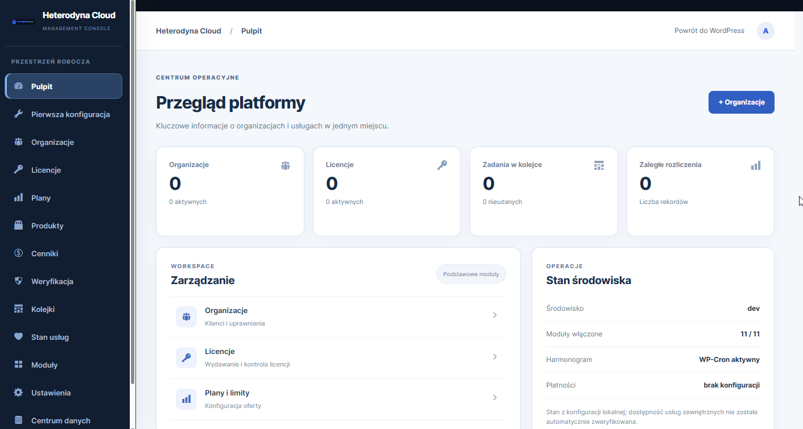

  

<h1 align="center">Heterodyna Cloud Platform</h1>

  <strong>Modułowa platforma do zarządzania usługami SaaS w WordPress.</strong> 
  Organizacje, dostęp, licencje, subskrypcje i automatyzacje w jednym panelu.

  <a href="https://github.com/HeterodynaTeamSoftware/Heterodyna-Cloud-Platform/releases"><strong>📦 POBIERZ — RELEASES</strong></a>
  &nbsp;·&nbsp;
  <a href="https://heterodynateamsoftware.pl/projekty/heterodyna-cloud-platform/">Strona projektu</a>
  &nbsp;·&nbsp;
  <a href="https://github.com/HeterodynaTeamSoftware/Heterodyna-Cloud-Platform/issues">Zgłoś problem</a>

---

## Zrzuty ekranu

### Pulpit platformy

## O projekcie

**Heterodyna Cloud Platform** to otwartoźródłowa wtyczka WordPress stanowiąca podstawę do budowy i administracji usługami SaaS. Łączy zarządzanie organizacjami, kontami i uprawnieniami z modułami licencji, subskrypcji oraz monitorowania działania platformy.

### Najważniejsze możliwości

- **Organizacje i użytkownicy** — obsługa wielu organizacji (tenants), członkostwa i ról dostępu.
- **Licencje i subskrypcje** — ewidencja licencji, planów, limitów i wykorzystania zasobów.
- **Portal klienta** — podgląd danych organizacji i własnego wykorzystania usług.
- **Rozszerzenia** — modułowy silnik i menedżer rozszerzeń z kontrolą zależności.
- **Automatyzacje** — zadania w tle, kolejka i integracje webhook.
- **Monitoring i diagnostyka** — przegląd statusów, zdarzeń i alertów administracyjnych.
- **REST API** — interfejs integracyjny z kontrolą uprawnień.

## Instalacja

1. Otwórz [**GitHub Releases**](https://github.com/HeterodynaTeamSoftware/Heterodyna-Cloud-Platform/releases) i pobierz ZIP wtyczki.
2. W WordPress przejdź do **Wtyczki → Dodaj nową → Wyślij wtyczkę na serwer**.
3. Wybierz archiwum, zainstaluj i aktywuj wtyczkę.
4. Skonfiguruj organizacje, dostęp i potrzebne moduły w panelu administracyjnym.

Portal klienta można umieścić na stronie przez shortcode `[heterodyna_cloud_portal]`.

### Wymagania

| Element | Wymaganie |
| --- | --- |
| WordPress | 6.0 lub nowszy |
| PHP | 8.0 lub nowszy |
| Baza danych | MySQL / zgodny silnik WordPress |

**Wersja rozwojowa 03.00.182:** przed użyciem na produkcji zalecane jest przetestowanie uprawnień, izolacji organizacji i integracji w środowisku testowym.

## Licencja i autor

**Autor:** [Heterodyna Team Software](https://heterodynateamsoftware.pl/) · **Licencja:** [GPL-2.0-or-later](LICENSE).
